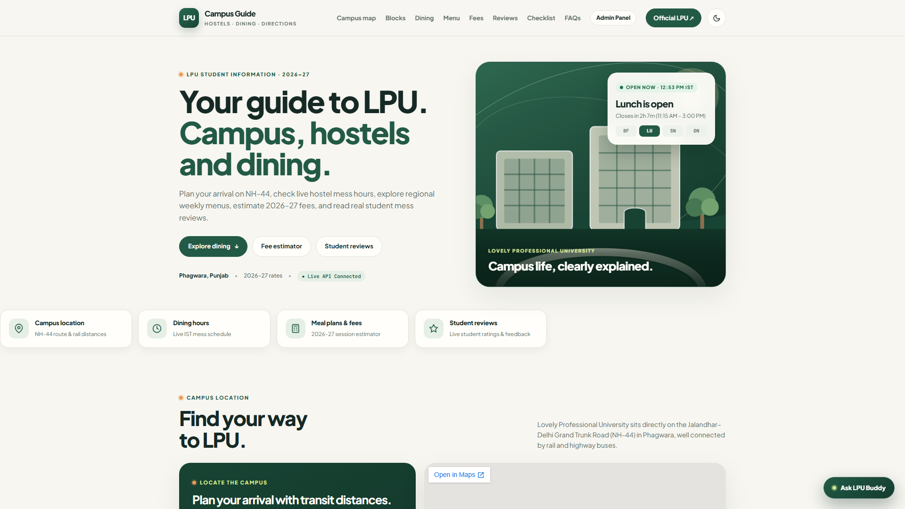

# LPU Campus Guide (2026–27) — Web Portal

An interactive student guide for **Lovely Professional University (LPU), Phagwara** built with **HTML5, CSS3, Vanilla JavaScript (ES6+), Node.js, and Express 5** with persistent **JSON data storage (`data/campus-data.json`)**. It pairs a warm editorial UI (plus Dark Mode) with live IST dining hours, North & South Indian weekly menus, an interactive 2026–27 Mess + Hostel + EDB fee estimator, student mess reviews, a fresher checklist, a smart campus assistant, and an **Admin Control Panel (`/admin`)**.

## Live Deployments & Presentation Files

- **Live Cloud Web App (Railway):** https://lpu-campus-guide-app-production.up.railway.app
- **GitHub Pages Mirror:** https://iamaryaann.github.io/lpu-campus-guide-2026/
- **Admin Control Panel:** https://lpu-campus-guide-app-production.up.railway.app/admin
- **Team PowerPoint Deck (11 Slides):** [LPU-Campus-Guide-Presentation.pptx](./LPU-Campus-Guide-Presentation.pptx)
- **Team Presentation Video (1080p · Aryan, Rimjhim & Piyush):** [LPU-Team-All-In-One-Video.mp4](./LPU-Team-All-In-One-Video.mp4)



## Tech Stack

- **Frontend:** HTML5, CSS3, Vanilla JavaScript (`public/index.html`, `public/style.css`, `public/script.js`, `public/shared-store.js`)
- **Backend:** Node.js + Express 5 (`server.js`)
- **Data Persistence:** Pure JavaScript JSON File Store (`db.js` -> `data/campus-data.json`) + `localStorage` offline fallback
- **CI / Hosting:** GitHub Actions Pages workflow (`.github/workflows/pages.yml`) + Railway Cloud

## Run Locally

```bash
npm install
npm start
```

- **Main Website:** `http://127.0.0.1:3000`
- **Admin Dashboard:** `http://127.0.0.1:3000/admin` (Default passcode: `lpu2026`)

## REST API Endpoints

| Method | Endpoint | Description |
| :--- | :--- | :--- |
| `GET` | `/api/health` | Server health status |
| `GET` | `/api/bootstrap` | Hydrates timings, weekly menus, mess plans, room tiers, blocks, polls & reviews |
| `GET` | `/api/menu` | Fetch all or specific day/cuisine menu (`?cuisine=north&day=1`) |
| `GET` | `/api/plans` | Fetch 2026–27 mess plans & hostel room tiers |
| `GET` | `/api/reviews` | Fetch student mess reviews & average star rating |
| `POST` | `/api/reviews` | Submit a new student mess review (`1–5` stars) |
| `POST` | `/api/queries` | Save a student/fresher campus question |
| `GET` | `/api/blocks` | Search & filter LPU campus blocks, hostels & landmarks (`?q=34&category=Academic`) |
| `GET` | `/api/polls` | Fetch live IST daily meal poll counts (`north` & `south` kitchens) |
| `POST` | `/api/polls/vote` | Cast or switch a live vote on today's meal |
| `POST` | `/api/chat` | Ask **LPU Buddy** smart assistant (Hinglish & English QA) |
| `GET` | `/api/admin/overview` | Protected overview for Admin Dashboard (`x-admin-key` header) |
| `PUT` | `/api/admin/menu` | Edit any day/cuisine menu |
| `PUT` | `/api/admin/plans/:id` | Update any 2026–27 mess plan fee or subtitle |
| `PATCH` | `/api/admin/queries/:id` | Reply to & resolve a student query (surfaces in public FAQs) |
| `DELETE` | `/api/admin/reviews/:id` | Moderate/remove a student review |

## Project Structure

```text
lpu-campus-guide/
├── .github/workflows/
│   └── pages.yml          # GitHub Pages auto-deployment workflow
├── data/
│   └── campus-data.json   # Persistent JSON data store
├── public/
│   ├── index.html         # Semantic HTML5 frontend structure
│   ├── style.css          # Warm-editorial CSS3 theme, responsive layout & dark mode
│   ├── script.js          # Main Vanilla JS (IST clock, Block Finder, Poll, Estimator, Chatbot)
│   ├── shared-store.js    # API client with Cloud + localStorage fallback
│   └── admin.html         # Protected Admin Control Panel (/admin)
├── db.js                  # JavaScript JSON store & initial seed data
├── server.js              # Express 5 REST API, CORS & static file server
├── package.json
├── preview.png
└── README.md
```
