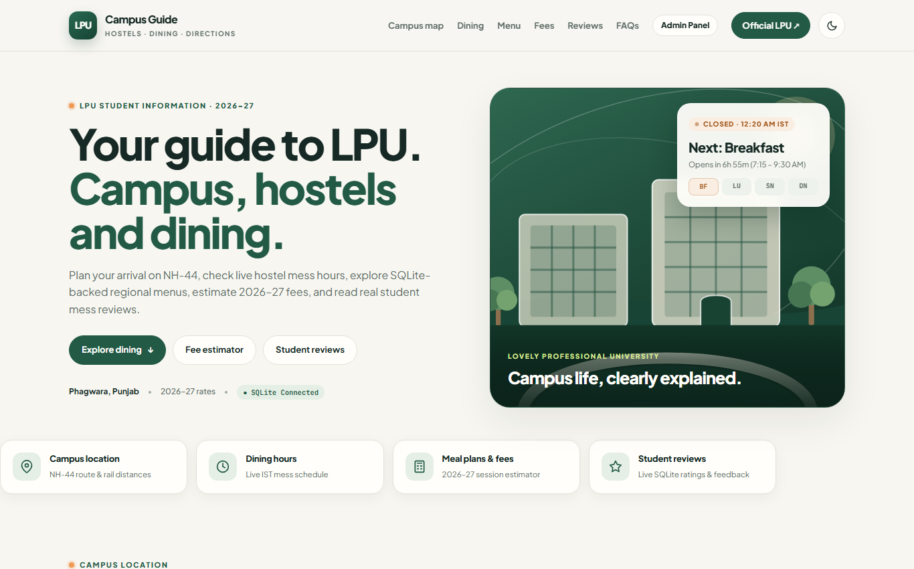

# LPU Campus Guide (2026–27) — Full-Stack Edition

A full-stack student guide for **Lovely Professional University (LPU), Phagwara** built with **Node.js, Express 5, and native SQLite (`node:sqlite`)**. It pairs a warm editorial UI (plus Dark Mode) with live IST dining hours, database-driven North & South Indian weekly menus, an interactive 2026–27 Mess + Hostel + EDB fee estimator, student mess reviews/ratings, a fresher doubt box, and a protected **Admin Control Panel (`/admin`)**.

## Live Deployments

- **Full-Stack Cloud App (Railway + Persistent SQLite):** https://lpu-campus-guide-app-production.up.railway.app
- **GitHub Pages Mirror (Connected to Cloud API):** https://iamaryaann.github.io/lpu-campus-guide-2026/
- **Admin Control Panel:** https://lpu-campus-guide-app-production.up.railway.app/admin



## Tech Stack

- **Frontend:** HTML5, CSS3, Vanilla JavaScript, custom inline SVGs (`public/index.html`, `public/admin.html`, `public/shared-store.js`)
- **Backend:** Node.js (`>=22.5.0`) + Express 5 (`server.js`)
- **Database:** Native SQLite (`node:sqlite` -> `data/campus.db` locally or `/data/campus.db` persistent volume on Railway via `db.js`)
- **CI / Hosting:** GitHub Actions Pages workflow (`.github/workflows/pages.yml`) + Railway continuous deployment

## Run Locally

```bash
npm install
npm start
```

- **Main Website:** `http://127.0.0.1:3000`
- **Admin Dashboard:** `http://127.0.0.1:3000/admin` (Default passcode: `lpu2026`, override via `ADMIN_KEY`)

## REST API Endpoints

| Method | Endpoint | Description |
| :--- | :--- | :--- |
| `GET` | `/api/health` | Server & SQLite health status |
| `GET` | `/api/bootstrap` | Hydrates timings, weekly menus, mess plans, room tiers, reviews & resolved Q&As |
| `GET` | `/api/menu` | Fetch all or specific day/cuisine menu (`?cuisine=north&day=1`) |
| `GET` | `/api/plans` | Fetch 2026–27 mess plans & hostel room tiers |
| `GET` | `/api/reviews` | Fetch student mess reviews & average star rating |
| `POST` | `/api/reviews` | Submit a new student mess review (`1–5` stars) into SQLite |
| `POST` | `/api/queries` | Save a student/fresher campus question into SQLite |
| `GET` | `/api/admin/overview` | Protected overview for Admin Dashboard (`x-admin-key` header) |
| `PUT` | `/api/admin/menu` | Edit any day/cuisine menu in SQLite |
| `PUT` | `/api/admin/plans/:id` | Update any 2026–27 mess plan fee or subtitle |
| `PATCH` | `/api/admin/queries/:id` | Reply to & resolve a student query (surfaces in public FAQs) |
| `DELETE` | `/api/admin/reviews/:id` | Moderate/remove a student review |

## Project Structure

```text
lpu-campus-guide/
├── .github/workflows/
│   └── pages.yml          # GitHub Pages auto-deployment workflow
├── data/
│   └── campus.db          # Auto-generated SQLite database (local / Railway volume)
├── public/
│   ├── index.html         # Main campus guide frontend
│   ├── admin.html         # Protected Admin Control Panel (/admin)
│   └── shared-store.js    # API client with Cloud + localStorage fallback
├── db.js                  # SQLite schema & initial seed data
├── server.js              # Express 5 REST API, CORS & static file server
├── package.json
├── preview.png
└── README.md
```
